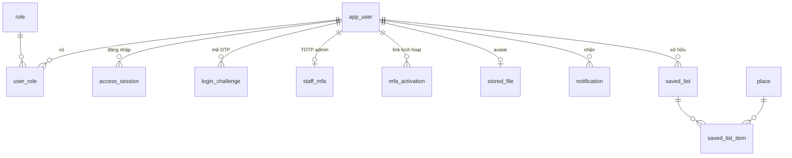
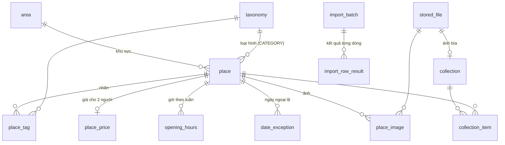
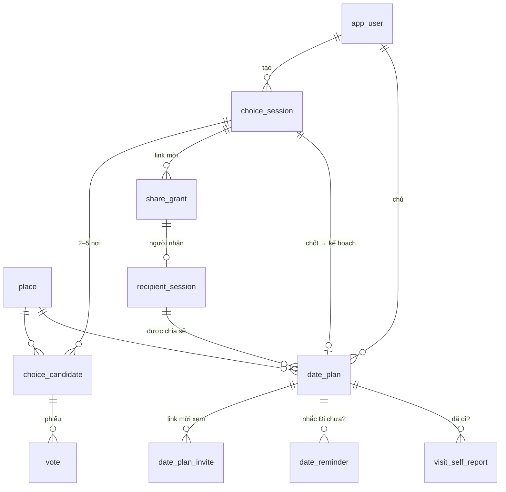
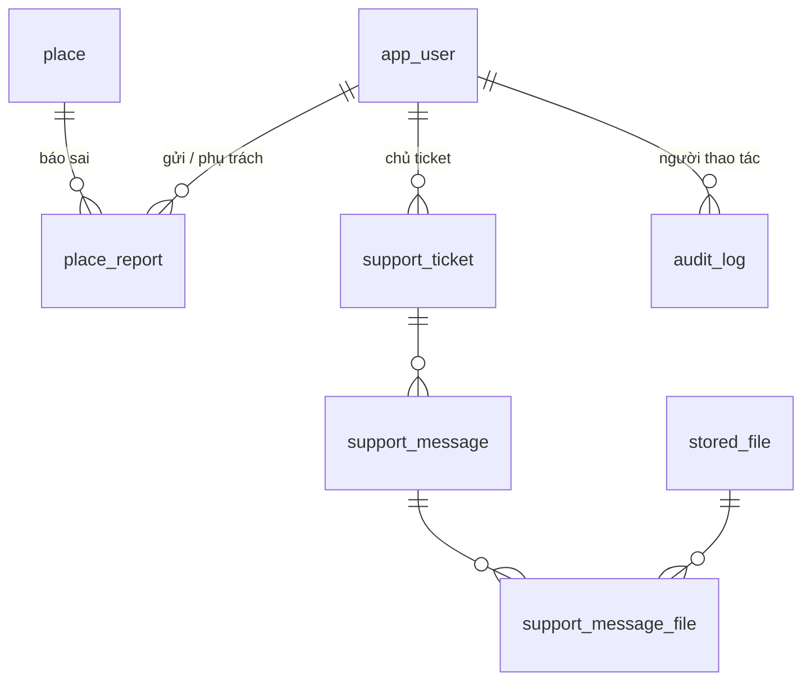

# Cấu trúc database — GoWithBae G1

Tài liệu này mô tả **database đang chạy thật** sau migration V1 → V405 (PostgreSQL 17 / Supabase). Danh sách cột ở mục 5 được sinh từ schema thật (`information_schema`, `pg_constraint`, `pg_indexes`), không chép tay. Đổi schema thì viết migration mới rồi cập nhật tài liệu này.

Liên quan: [FLOWS.md](FLOWS.md) (luồng chức năng và API) · [DEVELOPMENT.md](DEVELOPMENT.md) §5 (quy tắc migration).

## 1. Tổng quan

| | |
|---|---|
| Số bảng | 41 (không tính `flyway_schema_history`) |
| Khóa chính | `uuid` (`gen_random_uuid()`), trừ `audit_log.id` (bigint tự tăng) và các bảng nối dùng PK ghép |
| Thời gian | `timestamptz`, lưu UTC, hiển thị giờ Việt Nam; ngày kiểm tra dùng `date` |
| Tiền | `bigint`, đơn vị VND |
| Trạng thái | `text` + `CHECK (... IN (...))`, không dùng kiểu enum của Postgres, để thêm giá trị chỉ cần thay CHECK |
| Bảo mật Supabase | Mọi bảng **bật RLS** và không có policy nào: Data API (`anon`, `authenticated`) không đọc/ghi được. Chỉ backend (role sở hữu) truy cập |
| Token, mã | Chỉ lưu **hash** (SHA-256 cho token link, hash cho mã OTP); secret TOTP lưu **mã hóa AES-GCM** |
| Xóa dữ liệu | Hầu hết khóa ngoại là RESTRICT (không xóa dây chuyền). Chỉ `collection_item`, `saved_list_item`, `date_plan_invite` xóa theo cha |
| Nhật ký | `audit_log` chỉ được thêm: trigger `trg_audit_log_immutable` chặn mọi `UPDATE`/`DELETE` (TRUNCATE trong test không bị chặn) |
| Tìm kiếm | `place.search_text` có index GIN trigram (extension `pg_trgm`) cho `LIKE '%từ khóa%'` |
| Chuỗi bắt buộc | Tên địa điểm, tên danh sách, nguồn ảnh, nội dung tin nhắn hỗ trợ không được là chuỗi rỗng (CHECK `btrim(...) <> ''`) |

## 2. Sơ đồ quan hệ

### 2.1 Tài khoản và phiên (A)

### 2.2 Địa điểm, danh mục, nội dung (B)

### 2.3 Cùng chọn và kế hoạch hẹn (C)

### 2.4 Hỗ trợ và hệ thống

`analytics_event`, `idempotency_record`, `request_rate_limit`, `site_content` không có khóa ngoại bắt buộc (sự kiện có thể của khách ẩn danh; khóa chống trùng và giới hạn tần suất dùng chuỗi băm).

## 3. Bảng theo module, API và màn hình

| Module | Bảng | API chính | Màn hình |
|---|---|---|---|
| Tài khoản (A) | `app_user`, `role`, `user_role`, `login_challenge`, `access_session`, `staff_mfa`, `mfa_activation` | `/auth/*`, `/me`, `/admin/users/*` | Đăng nhập, Tài khoản, Admin → Tài khoản, `/admin/activate/:token` |
| Tệp (A) | `stored_file` | `POST /uploads`, `GET /files/{id}` | Ảnh địa điểm/bộ sưu tập, đính kèm hỗ trợ, báo sai |
| Đã lưu, thông báo (A) | `saved_list`, `saved_list_item`, `notification` | `/saved-lists/*`, `/notifications` | Đã lưu, chuông thông báo |
| Địa điểm (B) | `place`, `place_price`, `opening_hours`, `date_exception`, `place_tag`, `place_image` | `/places/*`, `/admin/places/*` | Khám phá, Kết quả, Chi tiết, So sánh; Admin → Địa điểm |
| Danh mục (B) | `area`, `taxonomy` | `/areas`, `/taxonomies`, `/admin/areas`, `/admin/taxonomies` | Bộ lọc; Admin → Nhãn & khu vực |
| Bộ sưu tập (B) | `collection`, `collection_item` | `/collections/*`, `/admin/collections/*` | Khám phá; Admin → Bộ sưu tập |
| Nhập CSV (B) | `import_batch`, `import_row_result` | `/admin/imports/*` | Admin → Nhập CSV |
| Nội dung web (B) | `site_content` | `/site-content`, `/admin/site-content` | Trang chủ, banner, chân trang, `/faq` `/terms` `/privacy` `/contact`; Admin → Nội dung web |
| Cùng chọn (C) | `choice_session`, `choice_candidate`, `share_grant`, `recipient_session`, `vote` | `/choice-sessions/*`, `/share-grants/*` | Tạo lời mời, `/invite/:token`, Bỏ phiếu, Kết quả |
| Kế hoạch (C) | `date_plan`, `date_plan_invite`, `date_reminder`, `visit_self_report` | `/date-plans/*`, `/plan-invites/*`, `/me/places/{id}/visit-count` | Buổi hẹn, chi tiết kế hoạch, `/plan-invite/:token`, lời nhắc "Đi chưa?" |
| Báo sai, hỗ trợ (C) | `place_report`, `support_ticket`, `support_message`, `support_message_file` | `/places/{id}/reports`, `/support-tickets/*`, `/admin/place-reports/*`, `/admin/support-tickets/*` | Báo sai, Hỗ trợ; Admin → Báo sai, Yêu cầu hỗ trợ |
| Hệ thống (A) | `audit_log`, `analytics_event`, `idempotency_record`, `request_rate_limit` | `/admin/audit-logs`, `/events`, `/admin/reports/*` | Admin → Nhật ký, Bảng điều khiển |

## 4. Lịch sử migration

| Version | Người | Nội dung |
|---|---|---|
| V1 | chung | Toàn bộ schema G1 |
| V2 | chung | Dữ liệu tham chiếu: vai trò, nhãn lọc mặc định |
| V3 | chung | Bật RLS, khóa Supabase Data API |
| V4 | chung | Lời nhắc "Đi chưa?", chống trùng lượt đi |
| V100 | A | Giới hạn đăng nhập (`login_challenge`, `request_rate_limit`) |
| V101 | A | TOTP cho nhân viên (`staff_mfa`) |
| V300 | C | Chống gửi trùng (`idempotency_record`). **Đã chạy trên Supabase nhóm — không sửa** |
| V400 | quản trị | Link kích hoạt Authenticator (`mfa_activation`) |
| V401 | quản trị | Phiên lưu IP, trình duyệt, lần hoạt động cuối |
| V402 | quản trị | Nội dung web (`site_content`) + văn mẫu |
| V403 | C | Link mời xem kế hoạch (`date_plan_invite`) |
| V404 | chung | Index cho tìm kiếm (trigram), khóa ngoại hay truy vấn, hoạt động người dùng, nhật ký; CHECK loại thông báo và chuỗi rỗng; trigger nhật ký chỉ-thêm |
| V405 | A | Xóa tài khoản: trạng thái `DELETED`, cột `deletion_requested_at`, `deleted_at` |

`beforeMigrate.sql` (callback Flyway) tạo role `anon`, `authenticated` dạng NOLOGIN để migration chạy được cả trên Postgres thường lẫn Supabase. Migration mới phải đánh số lớn hơn số cao nhất đang có (hiện là V405), vì Flyway từ chối version thấp hơn version đã chạy.

Dữ liệu demo không nằm trong migration: `scripts/dev-seed.sql` (chạy tay, xem DEVELOPMENT.md §9.1).

## 5. Tham chiếu bảng

Ký hiệu: ✓ = `NOT NULL`; `→ bảng` = khóa ngoại; `{A, B}` = giá trị CHECK cho phép.

### 5.1 Tài khoản và phiên (A)

- `app_user`: tài khoản. Email duy nhất không phân biệt hoa thường. Khóa thì `status = LOCKED` + `locked_reason`. Yêu cầu xóa thì `DELETION_REQUESTED` + `deletion_requested_at` (tự xóa sau 30 ngày nếu admin không khôi phục). Đã xóa thì `DELETED` + `deleted_at`: dòng được giữ nhưng email đổi thành `deleted+<id>@deleted.invalid`, tên "Tài khoản đã xóa", dữ liệu cá nhân ở các bảng khác bị xóa.
- `role`, `user_role`: vai trò (MEMBER, SUPER_ADMIN, EDITOR, REVIEWER, SUPPORT) và gán vai trò cho tài khoản, có người cấp.
- `login_challenge`: mã OTP email (đăng nhập, đổi email); chỉ lưu hash, đếm số lần sai.
- `access_session`: mỗi lần đăng nhập một dòng; JWT mang `sid` = id dòng này, thu hồi là mất hiệu lực ngay.
- `staff_mfa`: secret TOTP đã mã hóa của admin; `last_step` chống dùng lại mã.
- `mfa_activation`: link kích hoạt Authenticator dùng một lần, hạn 24 giờ, tối đa 5 lần sai.

#### `app_user`

| Cột | Kiểu | Bắt buộc | Mặc định | Ghi chú |
|---|---|---|---|---|
| `id` | uuid | ✓ | uuid | **PK** |
| `email` | text | ✓ |  |  |
| `display_name` | text | ✓ |  |  |
| `avatar_file_id` | uuid |  |  | → `stored_file` |
| `status` | text | ✓ | ACTIVE | {ACTIVE, LOCKED, DELETION_REQUESTED, DELETED} |
| `locked_reason` | text |  |  |  |
| `created_at` | timestamptz | ✓ | now() |  |
| `updated_at` | timestamptz | ✓ | now() |  |
| `deletion_requested_at` | timestamptz |  |  |  |
| `deleted_at` | timestamptz |  |  |  |

Ràng buộc và index thêm: CHECK `(((status = 'DELETED') = (deleted_at IS NOT NULL)))`; CHECK `(((status <> 'DELETION_REQUESTED') OR (deletion_requested_at IS NOT NULL)))`; `INDEX (deletion_requested_at) WHERE (status = 'DELETION_REQUESTED'::text)`; `UNIQUE INDEX (lower(email))`.

#### `role`

| Cột | Kiểu | Bắt buộc | Mặc định | Ghi chú |
|---|---|---|---|---|
| `code` | text | ✓ |  | **PK** |
| `name` | text | ✓ |  |  |

#### `user_role`

| Cột | Kiểu | Bắt buộc | Mặc định | Ghi chú |
|---|---|---|---|---|
| `user_id` | uuid | ✓ |  | **PK** · → `app_user` |
| `role_code` | text | ✓ |  | **PK** · → `role` |
| `granted_by` | uuid |  |  | → `app_user` |
| `granted_at` | timestamptz | ✓ | now() |  |

Ràng buộc và index thêm: `PK ghép (user_id, role_code)`.

#### `login_challenge`

| Cột | Kiểu | Bắt buộc | Mặc định | Ghi chú |
|---|---|---|---|---|
| `id` | uuid | ✓ | uuid | **PK** |
| `email` | text | ✓ |  |  |
| `purpose` | text | ✓ |  | {LOGIN, EMAIL_CHANGE} |
| `user_id` | uuid |  |  | → `app_user` |
| `code_hash` | text | ✓ |  |  |
| `attempts` | int | ✓ | 0 |  |
| `expires_at` | timestamptz | ✓ |  |  |
| `used_at` | timestamptz |  |  |  |
| `created_at` | timestamptz | ✓ | now() |  |

Ràng buộc và index thêm: `INDEX (lower(email), created_at DESC)`; `INDEX (user_id, purpose, created_at DESC)`.

#### `access_session`

| Cột | Kiểu | Bắt buộc | Mặc định | Ghi chú |
|---|---|---|---|---|
| `id` | uuid | ✓ | uuid | **PK** |
| `user_id` | uuid | ✓ |  | → `app_user` |
| `created_at` | timestamptz | ✓ | now() |  |
| `expires_at` | timestamptz | ✓ |  |  |
| `revoked_at` | timestamptz |  |  |  |
| `ip_address` | text |  |  |  |
| `user_agent` | text |  |  |  |
| `last_seen_at` | timestamptz |  |  |  |

Ràng buộc và index thêm: `INDEX (user_id) WHERE (revoked_at IS NULL)`; `INDEX (user_id, created_at DESC)`.

#### `staff_mfa`

| Cột | Kiểu | Bắt buộc | Mặc định | Ghi chú |
|---|---|---|---|---|
| `user_id` | uuid | ✓ |  | **PK** · → `app_user` |
| `secret_ciphertext` | text | ✓ |  |  |
| `last_step` | bigint | ✓ | -1 |  |
| `enrolled_at` | timestamptz | ✓ | now() |  |

#### `mfa_activation`

| Cột | Kiểu | Bắt buộc | Mặc định | Ghi chú |
|---|---|---|---|---|
| `id` | uuid | ✓ | uuid | **PK** |
| `user_id` | uuid | ✓ |  | → `app_user` |
| `token_hash` | text | ✓ |  |  |
| `secret_ciphertext` | text | ✓ |  |  |
| `attempts` | int | ✓ | 0 |  |
| `expires_at` | timestamptz | ✓ |  |  |
| `used_at` | timestamptz |  |  |  |
| `created_by` | uuid |  |  | → `app_user` |
| `created_at` | timestamptz | ✓ | now() |  |

Ràng buộc và index thêm: `UNIQUE (token_hash)`; `INDEX (user_id) WHERE (used_at IS NULL)`.

### 5.2 Địa điểm, danh mục, nội dung (B)

- `area`, `taxonomy`: khu vực và nhãn theo nhóm (CATEGORY là loại hình). Không xóa: đổi tên hoặc `DEPRECATED`.
- `place`: chi nhánh địa điểm. `search_text` = tên + khu vực + nhãn, bỏ dấu, chữ thường (backend tự tính lại khi sửa). `status` theo vòng đời nháp → chờ duyệt → hiển thị → tạm ẩn / ngừng.
- `place_price`: giá cho hai người; `KNOWN` phải có đủ chuẩn, min, max và `0 ≤ min ≤ chuẩn ≤ max`. Không có dòng = chưa ghi giá.
- `opening_hours`, `date_exception`: giờ mở theo thứ (1 = Thứ Hai … 7 = Chủ Nhật, khung qua nửa đêm được) và ngày ngoại lệ.
- `place_tag`, `place_image`: nhãn của địa điểm; ảnh (bắt buộc ghi nguồn/quyền, tối đa một ảnh bìa).
- `collection`, `collection_item`: bộ sưu tập khám phá, khung thời gian hiển thị, địa điểm có thứ tự.
- `import_batch`, `import_row_result`: lô nhập CSV và kết quả kiểm tra từng dòng.
- `site_content`: mỗi mục nội dung web một dòng jsonb (7 khóa cố định).

#### `area`

| Cột | Kiểu | Bắt buộc | Mặc định | Ghi chú |
|---|---|---|---|---|
| `id` | uuid | ✓ | uuid | **PK** |
| `code` | text | ✓ |  |  |
| `name` | text | ✓ |  |  |
| `status` | text | ✓ | ACTIVE | {ACTIVE, DEPRECATED} |

Ràng buộc và index thêm: `UNIQUE (code)`.

#### `taxonomy`

| Cột | Kiểu | Bắt buộc | Mặc định | Ghi chú |
|---|---|---|---|---|
| `id` | uuid | ✓ | uuid | **PK** |
| `group_code` | text | ✓ |  | {CATEGORY, ACTIVITY, VIBE, STYLE, SCENERY, FEATURE, AMENITY, OCCASION} |
| `code` | text | ✓ |  |  |
| `name` | text | ✓ |  |  |
| `status` | text | ✓ | ACTIVE | {ACTIVE, DEPRECATED} |

Ràng buộc và index thêm: `UNIQUE (group_code, code)`.

#### `place`

| Cột | Kiểu | Bắt buộc | Mặc định | Ghi chú |
|---|---|---|---|---|
| `id` | uuid | ✓ | uuid | **PK** |
| `code` | text | ✓ |  |  |
| `name` | text | ✓ |  |  |
| `search_text` | text | ✓ |  |  |
| `category_id` | uuid | ✓ |  | → `taxonomy` |
| `area_id` | uuid | ✓ |  | → `area` |
| `address` | text | ✓ |  |  |
| `lat` | double | ✓ |  |  |
| `lng` | double | ✓ |  |  |
| `description` | text |  |  |  |
| `phone` | text |  |  |  |
| `website` | text |  |  |  |
| `notes` | text |  |  |  |
| `reservation_recommended` | boolean |  |  |  |
| `hours_status` | text | ✓ | UNKNOWN | {KNOWN, UNKNOWN} |
| `status` | text | ✓ | DRAFT | {DRAFT, PENDING, PUBLISHED, HIDDEN, INACTIVE} |
| `status_reason` | text |  |  |  |
| `source` | text |  |  |  |
| `verified_at` | date |  |  |  |
| `created_by` | uuid |  |  | → `app_user` |
| `reviewed_by` | uuid |  |  | → `app_user` |
| `published_at` | timestamptz |  |  |  |
| `created_at` | timestamptz | ✓ | now() |  |
| `updated_at` | timestamptz | ✓ | now() |  |

Ràng buộc và index thêm: `UNIQUE (code)`; CHECK `((btrim(name) <> ''))`; CHECK `(((lat >= -90) AND (lat <= (90))))`; CHECK `(((lng >= -180) AND (lng <= (180))))`; `INDEX (category_id)`; `GIN INDEX (search_text gin_trgm_ops)`; `INDEX (status, area_id)`.

#### `place_price`

| Cột | Kiểu | Bắt buộc | Mặc định | Ghi chú |
|---|---|---|---|---|
| `place_id` | uuid | ✓ |  | **PK** · → `place` |
| `status` | text | ✓ | UNKNOWN | {KNOWN, UNKNOWN} |
| `standard_for_two` | bigint |  |  |  |
| `min_price` | bigint |  |  |  |
| `max_price` | bigint |  |  |  |
| `includes` | text |  |  |  |
| `source` | text |  |  |  |
| `verified_at` | date |  |  |  |

Ràng buộc và index thêm: CHECK `(((status = 'UNKNOWN') OR ((standard_for_two IS NOT NULL) AND (min_price IS NOT NULL) AND (max_price IS NOT NULL) AND (0 <= min_price) AND (min_price <= standard_for_two) AND (standard_for_two <= max_price))))`; `INDEX (standard_for_two) WHERE (status = 'KNOWN'::text)`.

#### `opening_hours`

| Cột | Kiểu | Bắt buộc | Mặc định | Ghi chú |
|---|---|---|---|---|
| `id` | uuid | ✓ | uuid | **PK** |
| `place_id` | uuid | ✓ |  | → `place` |
| `day_of_week` | smallint | ✓ |  |  |
| `opens_at` | time | ✓ |  |  |
| `closes_at` | time | ✓ |  |  |

Ràng buộc và index thêm: CHECK `(((day_of_week >= 1) AND (day_of_week <= 7)))`; `INDEX (place_id, day_of_week)`.

#### `date_exception`

| Cột | Kiểu | Bắt buộc | Mặc định | Ghi chú |
|---|---|---|---|---|
| `id` | uuid | ✓ | uuid | **PK** |
| `place_id` | uuid | ✓ |  | → `place` |
| `on_date` | date | ✓ |  |  |
| `closed` | boolean | ✓ |  |  |
| `opens_at` | time |  |  |  |
| `closes_at` | time |  |  |  |
| `note` | text |  |  |  |

Ràng buộc và index thêm: CHECK `((closed OR ((opens_at IS NOT NULL) AND (closes_at IS NOT NULL))))`; `INDEX (place_id, on_date)`.

#### `place_tag`

| Cột | Kiểu | Bắt buộc | Mặc định | Ghi chú |
|---|---|---|---|---|
| `place_id` | uuid | ✓ |  | **PK** · → `place` |
| `taxonomy_id` | uuid | ✓ |  | **PK** · → `taxonomy` |

Ràng buộc và index thêm: `PK ghép (place_id, taxonomy_id)`; `INDEX (taxonomy_id)`.

#### `place_image`

| Cột | Kiểu | Bắt buộc | Mặc định | Ghi chú |
|---|---|---|---|---|
| `id` | uuid | ✓ | uuid | **PK** |
| `place_id` | uuid | ✓ |  | → `place` |
| `file_id` | uuid | ✓ |  | → `stored_file` |
| `sort_order` | int | ✓ | 0 |  |
| `is_cover` | boolean | ✓ | false |  |
| `caption` | text |  |  |  |
| `source_rights` | text | ✓ |  |  |

Ràng buộc và index thêm: CHECK `((btrim(source_rights) <> ''))`; `INDEX (file_id)`; `UNIQUE INDEX (place_id) WHERE is_cover`.

#### `collection`

| Cột | Kiểu | Bắt buộc | Mặc định | Ghi chú |
|---|---|---|---|---|
| `id` | uuid | ✓ | uuid | **PK** |
| `title` | text | ✓ |  |  |
| `body` | text |  |  |  |
| `cover_file_id` | uuid |  |  | → `stored_file` |
| `visible_from` | timestamptz |  |  |  |
| `visible_until` | timestamptz |  |  |  |
| `created_by` | uuid |  |  | → `app_user` |
| `created_at` | timestamptz | ✓ | now() |  |
| `updated_at` | timestamptz | ✓ | now() |  |

Ràng buộc và index thêm: CHECK `(((visible_until IS NULL) OR (visible_from IS NULL) OR (visible_from < visible_until)))`; `INDEX (cover_file_id) WHERE (cover_file_id IS NOT NULL)`.

#### `collection_item`

| Cột | Kiểu | Bắt buộc | Mặc định | Ghi chú |
|---|---|---|---|---|
| `collection_id` | uuid | ✓ |  | **PK** · → `collection (xóa theo)` |
| `place_id` | uuid | ✓ |  | **PK** · → `place` |
| `sort_order` | int | ✓ | 0 |  |

Ràng buộc và index thêm: `PK ghép (collection_id, place_id)`; `INDEX (place_id)`.

#### `import_batch`

| Cột | Kiểu | Bắt buộc | Mặc định | Ghi chú |
|---|---|---|---|---|
| `id` | uuid | ✓ | uuid | **PK** |
| `created_by` | uuid | ✓ |  | → `app_user` |
| `template_version` | text | ✓ |  |  |
| `status` | text | ✓ |  | {VALIDATED, INVALID, COMMITTED} |
| `total_rows` | int | ✓ |  |  |
| `error_rows` | int | ✓ |  |  |
| `created_at` | timestamptz | ✓ | now() |  |
| `committed_at` | timestamptz |  |  |  |

#### `import_row_result`

| Cột | Kiểu | Bắt buộc | Mặc định | Ghi chú |
|---|---|---|---|---|
| `batch_id` | uuid | ✓ |  | **PK** · → `import_batch` |
| `row_number` | int | ✓ |  | **PK** |
| `place_code` | text |  |  |  |
| `valid` | boolean | ✓ |  |  |
| `errors` | jsonb | ✓ | [] |  |
| `raw` | jsonb | ✓ |  |  |

Ràng buộc và index thêm: `PK ghép (batch_id, row_number)`.

#### `site_content`

| Cột | Kiểu | Bắt buộc | Mặc định | Ghi chú |
|---|---|---|---|---|
| `key` | text | ✓ |  | **PK** · {homeHero, homeBanner, faq, terms, privacy, contact, footer} |
| `value` | jsonb | ✓ |  |  |
| `updated_by` | uuid |  |  | → `app_user` |
| `updated_at` | timestamptz | ✓ | now() |  |

### 5.3 Thành viên: tệp, đã lưu, thông báo (A)

- `stored_file`: metadata tệp tải lên (tệp nằm ở đĩa/bộ lưu trữ theo `storage_key`). Riêng tư mặc định; chỉ phục vụ công khai khi đã gắn vào địa điểm hoặc làm ảnh bìa bộ sưu tập.
- `saved_list`, `saved_list_item`: danh sách đã lưu riêng tư.
- `notification`: hộp thư trong web. `type`: DATE_PLAN_UPDATED, DATE_PLAN_CANCELLED, DATE_PLAN_INVITE_RESPONDED, SUPPORT_REPLIED, SUPPORT_STATUS_CHANGED, ADMIN_ANNOUNCEMENT (CHECK `ck_notification_type`; thêm loại mới phải sửa CHECK trong migration).

#### `stored_file`

| Cột | Kiểu | Bắt buộc | Mặc định | Ghi chú |
|---|---|---|---|---|
| `id` | uuid | ✓ | uuid | **PK** |
| `owner_user_id` | uuid |  |  | → `app_user` |
| `purpose` | text | ✓ |  | {AVATAR, PLACE_IMAGE, PLACE_REPORT, SUPPORT, COLLECTION} |
| `content_type` | text | ✓ |  |  |
| `size_bytes` | bigint | ✓ |  |  |
| `storage_key` | text | ✓ |  |  |
| `created_at` | timestamptz | ✓ | now() |  |

Ràng buộc và index thêm: `UNIQUE (storage_key)`; CHECK `((size_bytes > 0))`.

#### `saved_list`

| Cột | Kiểu | Bắt buộc | Mặc định | Ghi chú |
|---|---|---|---|---|
| `id` | uuid | ✓ | uuid | **PK** |
| `owner_id` | uuid | ✓ |  | → `app_user` |
| `name` | text | ✓ |  |  |
| `created_at` | timestamptz | ✓ | now() |  |
| `updated_at` | timestamptz | ✓ | now() |  |

Ràng buộc và index thêm: CHECK `((btrim(name) <> ''))`; `INDEX (owner_id)`.

#### `saved_list_item`

| Cột | Kiểu | Bắt buộc | Mặc định | Ghi chú |
|---|---|---|---|---|
| `list_id` | uuid | ✓ |  | **PK** · → `saved_list (xóa theo)` |
| `place_id` | uuid | ✓ |  | **PK** · → `place` |
| `added_at` | timestamptz | ✓ | now() |  |

Ràng buộc và index thêm: `PK ghép (list_id, place_id)`; `INDEX (place_id)`.

#### `notification`

| Cột | Kiểu | Bắt buộc | Mặc định | Ghi chú |
|---|---|---|---|---|
| `id` | uuid | ✓ | uuid | **PK** |
| `recipient_id` | uuid | ✓ |  | → `app_user` |
| `type` | text | ✓ |  | {DATE_PLAN_UPDATED, DATE_PLAN_CANCELLED, DATE_PLAN_INVITE_RESPONDED, SUPPORT_REPLIED, SUPPORT_STATUS_CHANGED, ADMIN_ANNOUNCEMENT} |
| `object_type` | text |  |  |  |
| `object_id` | uuid |  |  |  |
| `summary` | text | ✓ |  |  |
| `read_at` | timestamptz |  |  |  |
| `created_at` | timestamptz | ✓ | now() |  |

Ràng buộc và index thêm: `INDEX (recipient_id, created_at DESC)`.

### 5.4 Cùng chọn và kế hoạch hẹn (C)

- `choice_session`, `choice_candidate`: phiên cùng chọn và 2–5 nơi ứng viên.
- `share_grant`: link mời cùng chọn (hash token, hạn, thu hồi). `recipient_session`: người nhận đã tham gia (mỗi phiên tối đa một người còn hiệu lực), token gửi qua header `X-Recipient-Session`.
- `vote`: phiếu Thích / Bỏ qua của chủ **hoặc** người nhận (đúng một trong hai cột người bỏ phiếu).
- `date_plan`: kế hoạch hẹn. Có `choice_session_id` + `recipient_session_id` nếu tạo từ cùng chọn (được chia sẻ cho người nhận).
- `date_plan_invite`: link mời xem kế hoạch tạo tay; mỗi kế hoạch tối đa một link còn hiệu lực; lưu câu trả lời GOING / NOT_GOING.
- `date_reminder`, `visit_self_report`: lời nhắc "Đi chưa?" và câu trả lời đã đi hay chưa (của chủ hoặc người nhận).

#### `choice_session`

| Cột | Kiểu | Bắt buộc | Mặc định | Ghi chú |
|---|---|---|---|---|
| `id` | uuid | ✓ | uuid | **PK** |
| `creator_id` | uuid | ✓ |  | → `app_user` |
| `status` | text | ✓ | WAITING | {WAITING, VOTING, FINALIZED} |
| `created_at` | timestamptz | ✓ | now() |  |
| `finalized_at` | timestamptz |  |  |  |

Ràng buộc và index thêm: `INDEX (creator_id)`.

#### `choice_candidate`

| Cột | Kiểu | Bắt buộc | Mặc định | Ghi chú |
|---|---|---|---|---|
| `id` | uuid | ✓ | uuid | **PK** |
| `session_id` | uuid | ✓ |  | → `choice_session` |
| `place_id` | uuid | ✓ |  | → `place` |
| `sort_order` | int | ✓ | 0 |  |

Ràng buộc và index thêm: `UNIQUE (session_id, place_id)`; `INDEX (place_id)`.

#### `share_grant`

| Cột | Kiểu | Bắt buộc | Mặc định | Ghi chú |
|---|---|---|---|---|
| `id` | uuid | ✓ | uuid | **PK** |
| `session_id` | uuid | ✓ |  | → `choice_session` |
| `token_hash` | text | ✓ |  |  |
| `expires_at` | timestamptz | ✓ |  |  |
| `revoked_at` | timestamptz |  |  |  |
| `created_at` | timestamptz | ✓ | now() |  |

Ràng buộc và index thêm: `UNIQUE (token_hash)`; `INDEX (session_id)`.

#### `recipient_session`

| Cột | Kiểu | Bắt buộc | Mặc định | Ghi chú |
|---|---|---|---|---|
| `id` | uuid | ✓ | uuid | **PK** |
| `share_grant_id` | uuid | ✓ |  | → `share_grant` |
| `session_id` | uuid | ✓ |  | → `choice_session` |
| `display_name` | text | ✓ |  |  |
| `token_hash` | text | ✓ |  |  |
| `created_at` | timestamptz | ✓ | now() |  |
| `revoked_at` | timestamptz |  |  |  |

Ràng buộc và index thêm: `UNIQUE (token_hash)`; `INDEX (share_grant_id)`; `UNIQUE INDEX (session_id) WHERE (revoked_at IS NULL)`.

#### `vote`

| Cột | Kiểu | Bắt buộc | Mặc định | Ghi chú |
|---|---|---|---|---|
| `id` | uuid | ✓ | uuid | **PK** |
| `candidate_id` | uuid | ✓ |  | → `choice_candidate` |
| `voter_user_id` | uuid |  |  | → `app_user` |
| `voter_recipient_id` | uuid |  |  | → `recipient_session` |
| `preference` | text | ✓ |  | {LIKE, SKIP} |
| `updated_at` | timestamptz | ✓ | now() |  |

Ràng buộc và index thêm: CHECK `(((voter_user_id IS NULL) <> (voter_recipient_id IS NULL)))`; `UNIQUE INDEX (candidate_id, voter_recipient_id) WHERE (voter_recipient_id IS NOT NULL)`; `UNIQUE INDEX (candidate_id, voter_user_id) WHERE (voter_user_id IS NOT NULL)`.

#### `date_plan`

| Cột | Kiểu | Bắt buộc | Mặc định | Ghi chú |
|---|---|---|---|---|
| `id` | uuid | ✓ | uuid | **PK** |
| `owner_id` | uuid | ✓ |  | → `app_user` |
| `place_id` | uuid | ✓ |  | → `place` |
| `scheduled_at` | timestamptz | ✓ |  |  |
| `note` | text |  |  |  |
| `status` | text | ✓ | SCHEDULED | {SCHEDULED, CANCELLED, PAST} |
| `choice_session_id` | uuid |  |  | → `choice_session` |
| `recipient_session_id` | uuid |  |  | → `recipient_session` |
| `created_at` | timestamptz | ✓ | now() |  |
| `updated_at` | timestamptz | ✓ | now() |  |

Ràng buộc và index thêm: `UNIQUE (choice_session_id)`; `INDEX (scheduled_at) WHERE (status = 'SCHEDULED'::text)`; `INDEX (owner_id, scheduled_at DESC)`; `INDEX (place_id)`; `INDEX (recipient_session_id) WHERE (recipient_session_id IS NOT NULL)`.

#### `date_plan_invite`

| Cột | Kiểu | Bắt buộc | Mặc định | Ghi chú |
|---|---|---|---|---|
| `id` | uuid | ✓ | uuid | **PK** |
| `plan_id` | uuid | ✓ |  | → `date_plan (xóa theo)` |
| `token_hash` | text | ✓ |  |  |
| `created_at` | timestamptz | ✓ | now() |  |
| `revoked_at` | timestamptz |  |  |  |
| `response` | text |  |  | {GOING, NOT_GOING} |
| `guest_name` | text |  |  |  |
| `responded_at` | timestamptz |  |  |  |

Ràng buộc và index thêm: `UNIQUE (token_hash)`; CHECK `(((response IS NULL) = (responded_at IS NULL)))`; CHECK `(((guest_name IS NULL) OR ((char_length(guest_name) >= 1) AND (char_length(guest_name) <= 50))))`; `UNIQUE INDEX (plan_id) WHERE (revoked_at IS NULL)`.

#### `date_reminder`

| Cột | Kiểu | Bắt buộc | Mặc định | Ghi chú |
|---|---|---|---|---|
| `id` | uuid | ✓ | uuid | **PK** |
| `plan_id` | uuid | ✓ |  | → `date_plan` |
| `recipient_user_id` | uuid |  |  | → `app_user` |
| `recipient_session_id` | uuid |  |  | → `recipient_session` |
| `scheduled_at` | timestamptz | ✓ |  |  |
| `status` | text | ✓ | PENDING | {PENDING, SHOWN, DISMISSED, ANSWERED, CANCELLED} |
| `dismissed_at` | timestamptz |  |  |  |
| `answered_at` | timestamptz |  |  |  |
| `created_at` | timestamptz | ✓ | now() |  |
| `updated_at` | timestamptz | ✓ | now() |  |

Ràng buộc và index thêm: CHECK `(((recipient_user_id IS NULL) <> (recipient_session_id IS NULL)))`; CHECK `(((status = 'DISMISSED') = (dismissed_at IS NOT NULL)))`; CHECK `(((status = 'ANSWERED') = (answered_at IS NOT NULL)))`; `INDEX (scheduled_at) WHERE (status = ANY (ARRAY['PENDING'::text, 'SHOWN'::text]))`; `UNIQUE INDEX (plan_id, recipient_session_id) WHERE (recipient_session_id IS NOT NULL)`; `UNIQUE INDEX (plan_id, recipient_user_id) WHERE (recipient_user_id IS NOT NULL)`.

#### `visit_self_report`

| Cột | Kiểu | Bắt buộc | Mặc định | Ghi chú |
|---|---|---|---|---|
| `id` | uuid | ✓ | uuid | **PK** |
| `plan_id` | uuid | ✓ |  | → `date_plan` |
| `respondent_user_id` | uuid |  |  | → `app_user` |
| `respondent_recipient_id` | uuid |  |  | → `recipient_session` |
| `answer` | text | ✓ |  | {YES, NO} |
| `answered_at` | timestamptz | ✓ | now() |  |

Ràng buộc và index thêm: CHECK `(((respondent_user_id IS NULL) <> (respondent_recipient_id IS NULL)))`; `UNIQUE INDEX (plan_id, respondent_recipient_id) WHERE (respondent_recipient_id IS NOT NULL)`; `UNIQUE INDEX (plan_id, respondent_user_id) WHERE (respondent_user_id IS NOT NULL)`.

### 5.5 Báo sai và hỗ trợ (C)

- `place_report`: báo sai thông tin địa điểm; gửi được khi chưa đăng nhập (`sender_fingerprint` để chống lạm dụng); đóng phải có `resolution_note`.
- `support_ticket`, `support_message`, `support_message_file`: yêu cầu hỗ trợ, tin nhắn PUBLIC/INTERNAL, tệp đính kèm.

#### `place_report`

| Cột | Kiểu | Bắt buộc | Mặc định | Ghi chú |
|---|---|---|---|---|
| `id` | uuid | ✓ | uuid | **PK** |
| `place_id` | uuid | ✓ |  | → `place` |
| `reason` | text | ✓ |  | {WRONG_PRICE, WRONG_HOURS, WRONG_ADDRESS, CLOSED, WRONG_IMAGE, OTHER} |
| `description` | text |  |  |  |
| `file_id` | uuid |  |  | → `stored_file` |
| `sender_user_id` | uuid |  |  | → `app_user` |
| `sender_fingerprint` | text |  |  |  |
| `assignee_id` | uuid |  |  | → `app_user` |
| `status` | text | ✓ | NEW | {NEW, CHECKING, RESOLVED, INSUFFICIENT} |
| `resolution_note` | text |  |  |  |
| `created_at` | timestamptz | ✓ | now() |  |
| `updated_at` | timestamptz | ✓ | now() |  |

Ràng buộc và index thêm: CHECK `(((status <> ALL (ARRAY['RESOLVED', 'INSUFFICIENT'])) OR (resolution_note IS NOT NULL)))`; `INDEX (assignee_id) WHERE (assignee_id IS NOT NULL)`; `INDEX (place_id)`; `INDEX (status, created_at)`.

#### `support_ticket`

| Cột | Kiểu | Bắt buộc | Mặc định | Ghi chú |
|---|---|---|---|---|
| `id` | uuid | ✓ | uuid | **PK** |
| `owner_id` | uuid | ✓ |  | → `app_user` |
| `category` | text | ✓ |  | {ACCOUNT, PLACE_INFO, DATE_PLAN, OTHER} |
| `subject` | text | ✓ |  |  |
| `status` | text | ✓ | NEW | {NEW, IN_PROGRESS, WAITING_CUSTOMER, CLOSED} |
| `assignee_id` | uuid |  |  | → `app_user` |
| `created_at` | timestamptz | ✓ | now() |  |
| `updated_at` | timestamptz | ✓ | now() |  |

Ràng buộc và index thêm: `INDEX (assignee_id) WHERE (assignee_id IS NOT NULL)`; `INDEX (owner_id)`; `INDEX (status, updated_at)`.

#### `support_message`

| Cột | Kiểu | Bắt buộc | Mặc định | Ghi chú |
|---|---|---|---|---|
| `id` | uuid | ✓ | uuid | **PK** |
| `ticket_id` | uuid | ✓ |  | → `support_ticket` |
| `author_id` | uuid | ✓ |  | → `app_user` |
| `visibility` | text | ✓ |  | {PUBLIC, INTERNAL} |
| `body` | text | ✓ |  |  |
| `created_at` | timestamptz | ✓ | now() |  |

Ràng buộc và index thêm: CHECK `((btrim(body) <> ''))`; `INDEX (ticket_id, created_at)`.

#### `support_message_file`

| Cột | Kiểu | Bắt buộc | Mặc định | Ghi chú |
|---|---|---|---|---|
| `message_id` | uuid | ✓ |  | **PK** · → `support_message` |
| `file_id` | uuid | ✓ |  | **PK** · → `stored_file` |

Ràng buộc và index thêm: `PK ghép (message_id, file_id)`.

### 5.6 Hệ thống (A)

- `audit_log`: nhật ký thao tác quản trị (ai, lúc nào, đối tượng, trước/sau, lý do). Chỉ thêm: trigger chặn sửa/xóa kể cả khi chạy SQL tay.
- `analytics_event`: sự kiện phân tích có mã chống trùng (`event_id`), của thành viên hoặc khách ẩn danh.
- `idempotency_record`: kết quả request có `Idempotency-Key`, giữ 24 giờ để gửi lại không tạo trùng.
- `request_rate_limit`: bộ đếm giới hạn tần suất theo cửa sổ thời gian (OTP, báo sai, upload).

#### `audit_log`

| Cột | Kiểu | Bắt buộc | Mặc định | Ghi chú |
|---|---|---|---|---|
| `id` | bigint | ✓ |  | **PK** |
| `actor_id` | uuid |  |  | → `app_user` |
| `action` | text | ✓ |  |  |
| `object_type` | text | ✓ |  |  |
| `object_id` | text |  |  |  |
| `before_value` | jsonb |  |  |  |
| `after_value` | jsonb |  |  |  |
| `reason` | text |  |  |  |
| `trace_id` | text |  |  |  |
| `created_at` | timestamptz | ✓ | now() |  |

Ràng buộc và index thêm: `INDEX (action, created_at DESC)`; `INDEX (actor_id, created_at DESC) WHERE (actor_id IS NOT NULL)`; `INDEX (created_at DESC, id DESC)`; `INDEX (object_type, object_id, created_at DESC)`.

#### `analytics_event`

| Cột | Kiểu | Bắt buộc | Mặc định | Ghi chú |
|---|---|---|---|---|
| `event_id` | uuid | ✓ |  | **PK** |
| `name` | text | ✓ |  |  |
| `occurred_at` | timestamptz | ✓ |  |  |
| `received_at` | timestamptz | ✓ | now() |  |
| `session_id` | text | ✓ |  |  |
| `platform` | text | ✓ |  |  |
| `user_id` | uuid |  |  |  |
| `anonymous_id` | text |  |  |  |
| `object_id` | text |  |  |  |
| `props` | jsonb | ✓ | {} |  |

Ràng buộc và index thêm: CHECK `(((user_id IS NOT NULL) OR (anonymous_id IS NOT NULL)))`; `INDEX (name, occurred_at)`; `INDEX (user_id, occurred_at DESC) WHERE (user_id IS NOT NULL)`.

#### `idempotency_record`

| Cột | Kiểu | Bắt buộc | Mặc định | Ghi chú |
|---|---|---|---|---|
| `id` | uuid | ✓ | uuid | **PK** |
| `actor_key` | text | ✓ |  |  |
| `operation` | text | ✓ |  |  |
| `idem_key` | text | ✓ |  |  |
| `request_hash` | text | ✓ |  |  |
| `response_status` | int | ✓ |  |  |
| `response_body` | jsonb | ✓ |  |  |
| `created_at` | timestamptz | ✓ | now() |  |
| `expires_at` | timestamptz | ✓ | (now() + 24:00:00) |  |

Ràng buộc và index thêm: `UNIQUE (actor_key, operation, idem_key)`; `INDEX (expires_at)`.

#### `request_rate_limit`

| Cột | Kiểu | Bắt buộc | Mặc định | Ghi chú |
|---|---|---|---|---|
| `bucket` | text | ✓ |  | **PK** |
| `key_hash` | text | ✓ |  | **PK** |
| `window_start` | timestamptz | ✓ |  | **PK** |
| `hits` | int | ✓ |  |  |

Ràng buộc và index thêm: `PK ghép (bucket, key_hash, window_start)`; CHECK `((hits > 0))`; `INDEX (window_start)`.
